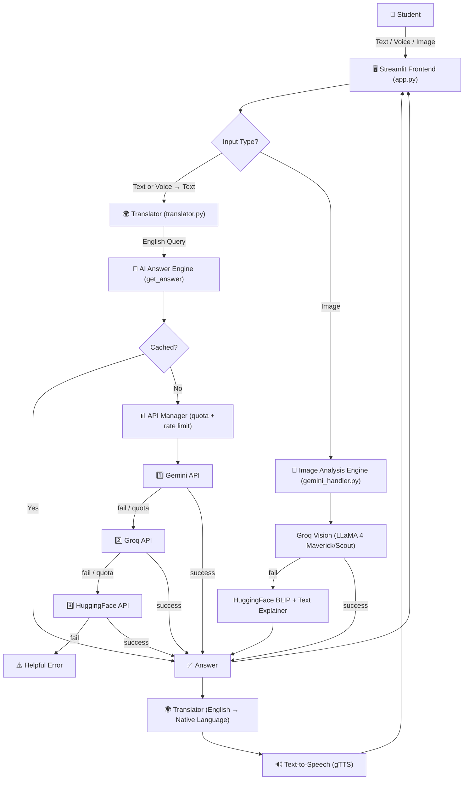
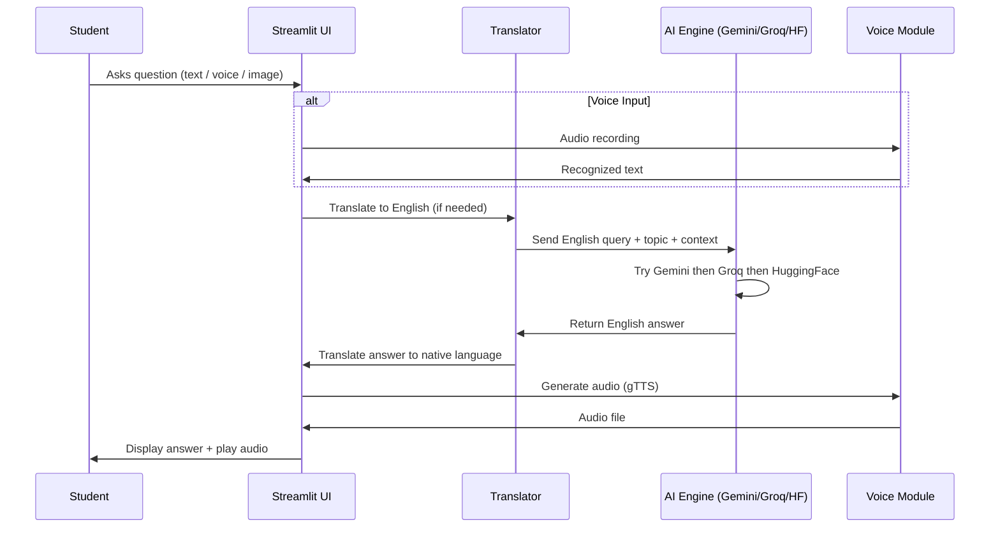
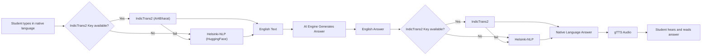
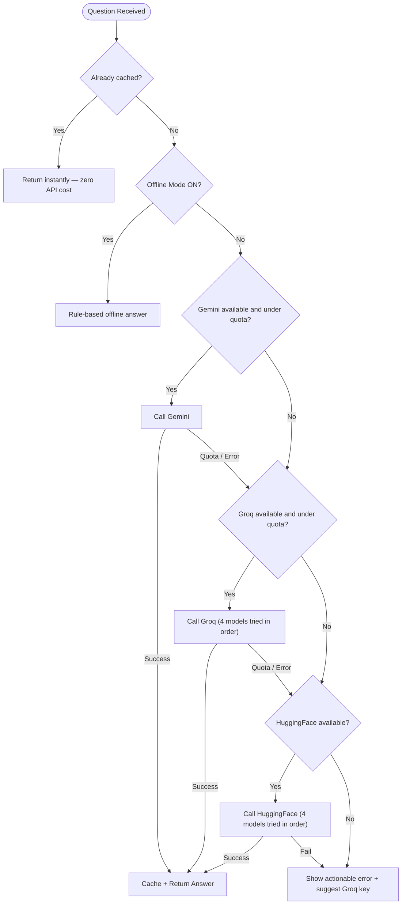

# EduBridge AI — Multilingual Learning Assistant for Rural Students

> **Edu**cation + **Bridge** — An AI-powered platform that bridges the educational gap for students in rural India by answering questions, explaining textbook images, and speaking in their own native language.

---

## 📋 Table of Contents

- [Problem Statement](#-problem-statement)
- [Objective](#-objective)
- [Purpose](#-purpose)
- [Use Cases](#-use-cases)
- [Features](#-features)
- [Tech Stack](#️-tech-stack)
- [System Architecture](#-system-architecture)
- [Application Flow](#-application-flow)
- [Translation Pipeline](#-translation-pipeline)
- [AI Fallback Strategy](#-ai-fallback-strategy)
- [Project Structure](#-project-structure)
- [Installation & Setup](#-installation--setup)
- [Deployment](#-deployment)
- [Advantages](#-advantages)
- [Limitations](#-limitations)
- [Future Scope](#-future-scope)
- [License](#-license)

---

## 🎯 Problem Statement

India has over **190 million students** in rural areas, the majority of whom face three compounding barriers to quality education:

1. **Language Barrier** — Most learning content, AI tools, and online resources are available only in English, while a large share of rural students are most comfortable in their regional mother tongue.
2. **Lack of Personal Guidance** — Teacher-to-student ratios in rural schools are often inadequate, leaving students without anyone to ask when they don't understand a concept.
3. **Limited Digital Infrastructure** — Inconsistent internet connectivity and low-literacy users make most existing ed-tech platforms impractical for rural use.

Existing AI chatbots (ChatGPT, Gemini, etc.) are powerful but assume **English fluency, stable internet, and text-based interaction** — none of which can be guaranteed for the intended audience. There is a clear need for a tool that can **explain concepts simply, in the student's own language, through voice or text, and even visually via image understanding** — while remaining usable on low connectivity.

---

## 🎯 Objective

To design and build a **multilingual, multimodal AI learning assistant** that:

- Answers academic questions in **11 Indian languages**
- Explains **images** (textbook pages, blackboard photos, diagrams)
- Accepts and responds to **voice input/output**
- Functions in a **basic offline mode** when internet is unavailable
- Remains **completely free to operate** using publicly available AI APIs
- **Never fails silently** — uses a multi-layer AI fallback so an answer is always available

---

## 💡 Purpose

EduBridge AI exists to **democratize access to personalized learning support**. It acts as an always-available, judgment-free tutor that:

- Removes the English-language gatekeeping of most AI tools
- Gives students a private space to ask "silly" questions without hesitation
- Converts passive content (a photo of a blackboard) into an interactive explanation
- Works as a **supplement to teachers**, not a replacement — filling gaps in availability, not curriculum

---

## 🧑‍🎓 Use Cases

| Scenario | How EduBridge AI Helps |
|----------|------------------------|
| A student doesn't understand a concept taught in class | Asks the same question in their mother tongue and gets a simple explanation |
| A student has a photo of blackboard notes but missed the explanation | Uploads the photo, AI describes and explains the content |
| A student wants to revise but has no one to ask at home | Chats with the AI anytime, no scheduling needed |
| A student is in an area with patchy internet | Switches to Offline Mode for foundational topic explanations |
| A student prefers listening over reading | Enables voice input and audio answers |
| A non-English speaking parent wants to help their child | Both can interact with the platform in their native language |

---

## ✨ Features

| Feature | Description |
|---------|-------------|
| 💬 **Multilingual Chat** | Ask and receive answers in Hindi, Tamil, Bengali, Telugu, Marathi, Gujarati, Kannada, Odia, Punjabi, Urdu, or English |
| 🤖 **Layered AI Engine** | Gemini → Groq → HuggingFace fallback chain ensures an answer is (almost) always returned |
| 🌍 **IndicTrans2 + Helsinki-NLP Translation** | High-quality Indian language translation with automatic fallback |
| 📸 **Image Analysis** | Upload textbook pages, blackboard photos, or diagrams — Groq Vision and HuggingFace explain them |
| 🎙️ **Live Voice Input** | Press-to-speak microphone with instant speech recognition |
| 🔊 **Voice Output (TTS)** | Every answer can be read aloud in the student's selected language |
| 📴 **Offline Mode** | Rule-based answers for foundational topics when there is no internet |
| 📚 **Subject Selector** | Tailors explanations to Math, Science, History, Geography, Civics, Agriculture, and more |
| 📊 **Smart API Usage Manager** | Tracks daily quota per API, caches repeated questions, and rate-limits requests automatically |
| 🌗 **Dark / Light Mode** | Full theme toggle for visual comfort |
| 🐛 **Debug Log** | Transparent log of which AI engine answered and why, for troubleshooting |

---

## 🛠️ Tech Stack

| Layer | Technology Used |
|-------|-----------------|
| **Frontend / UI** | [Streamlit](https://streamlit.io) |
| **Primary AI Engine** | Google Gemini (REST API — `gemini-2.0-flash-lite` and fallbacks) |
| **Backup AI Engine** | Groq (LLaMA 3.1 / 3.3, Mistral, Gemma2) |
| **Tertiary AI Engine** | HuggingFace Inference API (Mistral-7B, Zephyr, Phi-3) |
| **Image Understanding** | Groq Vision (LLaMA 4 Maverick / Scout) + HuggingFace BLIP captioning |
| **Translation Engine** | IndicTrans2 (AI4Bharat) with Helsinki-NLP (HuggingFace) fallback |
| **Speech-to-Text** | Google Speech Recognition via `SpeechRecognition` + `streamlit-audiorecorder` |
| **Text-to-Speech** | gTTS (Google Text-to-Speech) |
| **Audio Processing** | `pydub` + `ffmpeg` |
| **Offline Engine** | Custom rule-based Python response system |
| **API Quota Management** | Custom in-memory tracker (`api_manager.py`) |
| **Language** | Python 3.12 |

---

## 🏗️ System Architecture



---

## 🔄 Application Flow



---

## 🌐 Translation Pipeline



---

## 🧠 AI Fallback Strategy

The platform never depends on a single AI provider. Every question passes through a **priority chain** designed to maximize uptime within free-tier API limits:



| Priority | Engine | Free Daily Limit | Role |
|----------|--------|-------------------|------|
| 0 | **Cache** | Unlimited | Instant repeat-question answers |
| 1 | **Gemini** | ~1,500 requests/day | Primary answer engine |
| 2 | **Groq** | ~14,400 requests/day | High-capacity backup |
| 3 | **HuggingFace** | Varies by model | Final AI fallback |
| 4 | **Offline Rules** | Unlimited | Last resort, no internet needed |

---

## 📁 Project Structure

```
edubridge-ai/
│
├── app.py                # Streamlit frontend — UI, routing, theming, session state
├── gemini_handler.py      # All AI calls — Gemini, Groq, HuggingFace, image analysis
├── translator.py          # IndicTrans2 + Helsinki-NLP translation logic
├── voice_handler.py       # Speech-to-text (mic) + text-to-speech (gTTS)
├── api_manager.py         # Quota tracking, caching, rate limiting
├── requirements.txt       # Python dependencies
├── packages.txt           # System-level dependency (ffmpeg) for cloud deployment
├── .env.example           # Template for API key environment variables
├── .gitignore             # Excludes .env and other sensitive/local files
└── README.md              # Project documentation
```

---

## ⚙️ Installation & Setup

### 1. Clone the repository
```bash
git clone https://github.com/<your-username>/edubridge-ai.git
cd edubridge-ai
```

### 2. (Recommended) Create a virtual environment
```bash
python -m venv venv
source venv/bin/activate      # Mac/Linux
venv\Scripts\activate         # Windows
```

### 3. Install dependencies
```bash
pip install -r requirements.txt
```

### 4. Configure API keys
```bash
cp .env.example .env
```
Edit `.env` and add your free keys:

| Key | Get it from | Required |
|-----|-------------|----------|
| `GEMINI_API_KEY` | [aistudio.google.com](https://aistudio.google.com) | ✅ Recommended |
| `GROQ_API_KEY` | [console.groq.com](https://console.groq.com) | ✅ Recommended (backup) |
| `HF_TOKEN` | [huggingface.co/settings/tokens](https://huggingface.co/settings/tokens) | ✅ Required for translation |
| `INDICTRANS2_KEY` | [ai4bharat.org](https://ai4bharat.org) | ⚪ Optional |

> Alternatively, keys can be entered directly in the app's sidebar at runtime — no `.env` file is required to use the app.

### 5. Run the application
```bash
streamlit run app.py
```

### 6. Open in browser
```
http://localhost:8501
```

---

## 🚀 Deployment

### Streamlit Community Cloud (Free)

1. Push the repository to GitHub (ensure `.env` is excluded via `.gitignore`)
2. Go to [share.streamlit.io](https://share.streamlit.io) and sign in with GitHub
3. Click **New app** → select repository → set main file to `app.py`
4. Under **Settings → Secrets**, add:
   ```toml
   GEMINI_API_KEY = "..."
   GROQ_API_KEY = "..."
   HF_TOKEN = "..."
   ```
5. Deploy — the app will be live at `https://<app-name>.streamlit.app`

`packages.txt` ensures `ffmpeg` is installed automatically for voice features on the cloud.

---

## ✅ Advantages

- **No single point of failure** — three independent AI providers plus an offline mode
- **Genuinely accessible** — voice in, voice out, and native-language text for low-literacy or non-English-speaking users
- **Cost-efficient** — operates entirely within free API tiers; caching further reduces usage
- **Visual learning support** — can interpret and explain handwritten notes, diagrams, and textbook pages
- **Transparent operation** — debug log and API usage meters show exactly what is happening, building trust and aiding troubleshooting
- **Low infrastructure requirement** — runs as a lightweight web app, accessible from any modern browser

---

## ⚠️ Limitations

| Limitation | Detail |
|-----------|--------|
| Free-tier API limits | Gemini's free quota is modest; heavy use requires Groq/HuggingFace fallback or paid tiers |
| Offline mode coverage | Currently covers a limited set of foundational topics, not the full curriculum |
| Voice recognition accuracy | Depends on microphone quality, accent, and background noise |
| Translation nuance | Machine translation may not perfectly capture context for complex or ambiguous sentences |
| No persistent accounts | Chat history resets when the browser session ends (no login system yet) |

---

## 🔭 Future Scope

- 🔐 **User accounts & persistent history** — save progress and past conversations across sessions
- 📖 **NCERT curriculum alignment** — map answers directly to official syllabus chapters and grade levels
- 📡 **True offline-first mode** — bundle a small local language model (e.g., via Ollama or GGUF models) for full offline functionality, not just rule-based answers
- 🗣️ **Improved regional STT** — integrate dedicated Indian-language speech models (e.g., Vosk regional models) for higher voice recognition accuracy
- 📊 **Teacher/parent dashboard** — visibility into topics a student has struggled with or asked about most
- 📱 **Mobile-first redesign** — optimized layouts for low-end Android devices common in rural areas
- 🧩 **Quiz & flashcard generation** — auto-generate practice questions from any topic or uploaded material
- 🌐 **Expanded language support** — add more regional languages and dialects beyond the current 11
- ⚡ **Response streaming** — word-by-word answer rendering for a more responsive feel

---

## 📝 License

This project is released under the **MIT License** — free to use, modify, and distribute.

---

<p align="center">Built to bridge the gap between knowledge and access — for every student, in every language.</p>