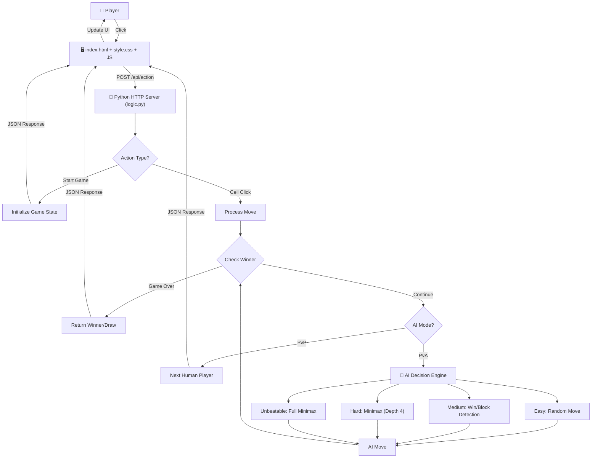
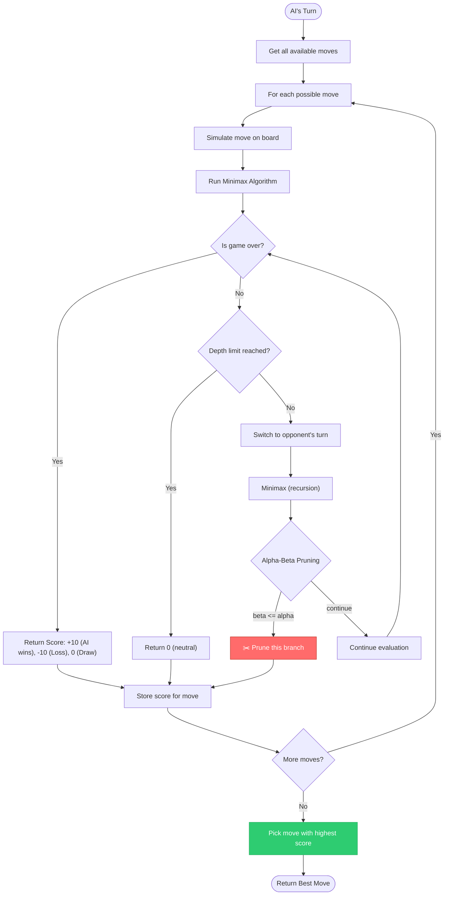

# Tic-Tac-Toe-AI — An Intelligent Web-Based Tic-Tac-Toe Game with Minimax AI

> **Tic-Tac-Toe** + **AI** — A web-based game featuring an intelligent AI opponent powered by the Minimax algorithm with Alpha-Beta Pruning, offering multiple difficulty levels and configurable grid sizes.

---

## 📋 Table of Contents

- [Problem Statement](#-problem-statement)
- [Objective](#-objective)
- [Purpose](#-purpose)
- [Use Cases](#-use-cases)
- [Features](#-features)
- [Tech Stack](#️-tech-stack)
- [System Architecture](#-system-architecture)
- [AI Algorithm Deep Dive](#-ai-algorithm-deep-dive)
- [Game Modes & Difficulty Levels](#-game-modes--difficulty-levels)
- [Project Structure](#-project-structure)
- [Installation & Setup](#-installation--setup)
- [How to Play](#-how-to-play)
- [Advantages](#-advantages)
- [Limitations](#-limitations)
- [Future Scope](#-future-scope)
- [All Rights Reserved](#-all-rights-reserved)

---

## 🎯 Problem Statement

Understanding artificial intelligence algorithms can be abstract and difficult without hands-on experience. Traditional textbook explanations of game theory concepts like Minimax, Alpha-Beta Pruning, and decision trees often fail to convey how these algorithms work in practice.

There is a need for:
1. **Interactive demonstrations** that make AI concepts tangible and engaging
2. **Visual representations** of algorithm decision-making in real-time
3. **Accessible tools** that require no setup or external dependencies
4. **Educational games** that teach while providing entertainment

A Tic-Tac-Toe game with adjustable AI difficulty provides the perfect platform to demonstrate these concepts—from random moves (Easy) to theoretically perfect play (Unbeatable).

---

## 🎯 Objective

To design and build an **intelligent Tic-Tac-Toe web application** that:

- Implements the **Minimax algorithm** with **Alpha-Beta Pruning** for AI decision-making
- Provides **four distinct difficulty levels** demonstrating different AI capabilities
- Supports **configurable grid sizes** from 2x2 to 9x9
- Offers **both PvP and PvA game modes** for flexible gameplay
- Uses **zero external dependencies** — runs on Python's standard library alone
- Creates an **educational tool** for learning game theory and AI concepts

---

## 💡 Purpose

Tic-Tac-Toe-AI exists to **democratize understanding of AI algorithms** through interactive gameplay. It serves as:

- An **educational demonstrator** for Minimax and Alpha-Beta Pruning
- A **learning tool** for students studying artificial intelligence and game theory
- A **playable game** that's fun for all ages
- A **reference implementation** showing clean, dependency-free Python code
- A **starting point** for anyone wanting to understand how game-playing AI works

---

## 🧑‍🎓 Use Cases

| Scenario | How Tic-Tac-Toe-AI Helps |
|----------|--------------------------|
| A student learning about AI algorithms | Plays against different difficulty levels to see how AI thinking changes |
| A teacher demonstrating game theory | Uses the game as a visual aid in classroom lectures |
| A developer learning Minimax | Studies the clean Python implementation in `logic.py` |
| Someone wanting to play Tic-Tac-Toe | Uses PvP mode for local two-player matches |
| Testing AI optimization techniques | Compares depth-limited vs full Minimax (Hard vs Unbeatable) |
| A parent teaching kids about AI | Shows how "smart" vs "dumb" AI differs in Easy vs Unbeatable modes |
| A CS student working on a project | Uses as reference or extends with new features |

---

## ✨ Features

| Feature | Description |
|---------|-------------|
| 🎮 **Multiple Game Modes** | Player vs. Player (PvP) and Player vs. AI (PvA) modes |
| 🤖 **4 AI Difficulty Levels** | Easy (random), Medium (heuristic), Hard (depth-limited Minimax), Unbeatable (full Minimax) |
| 📐 **Configurable Grid Sizes** | Play on 2x2 through 9x9 boards with adjusted win conditions |
| 🏆 **Session Scoreboard** | Tracks wins, losses, and draws for both PvP and PvA modes |
| 🔊 **Sound Effects** | Audio feedback for clicks, wins, and draws |
| ✨ **Animated UI** | Gradient backgrounds, glow effects, and pop-out text animations |
| 📱 **Responsive Design** | Game board adapts to different screen sizes |
| 🤔 **AI Thinking Indicator** | Shows "AI is thinking..." status during opponent's turn |
| 🎯 **Win Condition Display** | Clear indication of required pieces to win based on grid size |
| 🎨 **Modern Interface** | Clean, intuitive design with Google Fonts (Montserrat) |

---

## 🛠️ Tech Stack

| Layer | Technology Used |
|-------|-----------------|
| **Frontend / UI** | Vanilla HTML5 |
| **Styling** | Vanilla CSS3 (with CSS variables, gradients, animations) |
| **Client Logic** | Vanilla JavaScript (ES6+) |
| **Backend / Server** | Python 3 (`http.server` module — stdlib only) |
| **Game Logic** | Python 3 (custom implementation) |
| **AI Algorithm** | Minimax with Alpha-Beta Pruning (pure Python) |
| **Font** | Google Fonts (Montserrat) |
| **Audio** | Web Audio API (`Audio` objects) |
| **External Dependencies** | **None** — zero npm packages, zero pip packages |

---

## 🏗️ System Architecture



---

## 🧠 AI Algorithm Deep Dive

### Minimax with Alpha-Beta Pruning

The AI uses the **Minimax algorithm**, a decision-making algorithm for two-player zero-sum games. It simulates all possible moves and picks the one that maximizes the AI's chance of winning.



### How Alpha-Beta Pruning Works

- **Alpha (α):** Best score the maximizer (AI) can guarantee
- **Beta (β):** Best score the minimizer (opponent) can guarantee
- **Pruning:** If `β ≤ α`, remaining branches won't affect the decision → skip them

This optimization reduces the number of nodes evaluated from O(b^d) to approximately O(b^(d/2)) in best cases, where `b` is branching factor and `d` is depth.

---

## 🎮 Game Modes & Difficulty Levels

| Difficulty | Algorithm | Depth Limit | Behavior |
|------------|-----------|-------------|----------|
| 🟢 **Easy** | Random | N/A | Picks a random available cell. Perfect for beginners. |
| 🟡 **Medium** | Heuristic | N/A | Checks for immediate wins, then blocks opponent wins, then falls back to random. |
| 🟠 **Hard** | Minimax + α-β | 4 | Depth-limited search. Strong but beatable by skilled players. |
| 🔴 **Unbeatable** | Minimax + α-β | ∞ | Full game tree search. Theoretically perfect — will always at least draw. |

### Grid Sizes & Win Conditions

| Grid Size | Win Condition |
|-----------|---------------|
| 2×2 | 2 in a row |
| 3×3 | 3 in a row |
| 4×4 | 3 in a row |
| 5×5 | 4 in a row |
| 6×6 | 5 in a row |
| 7×7 | 5 in a row |
| 8×8 | 6 in a row |
| 9×9 | 6 in a row |

> **Note:** AI opponents (Medium/Hard/Unbeatable) only operate on the standard 3×3 grid. For other grid sizes, the AI falls back to random moves.

---

## 📁 Project Structure

```
Tic-Tac-Toe-AI/
│
├── index.html          # Frontend — single-page app with inline JavaScript
├── style.css           # Styling — responsive design, animations, gradients
├── logic.py            # Backend — Python HTTP server + AI logic + game state
├── sounds/
│   ├── click.wav       # Cell placement sound effect
│   ├── draw.wav        # Draw/tie sound effect
│   ├── ui-click.wav    # UI button click sound
│   └── win.wav         # Victory sound effect
└── README.md           # This documentation file
```

---

## ⚙️ Installation & Setup

### Prerequisites

- **Python 3.x** installed on your system
- A modern web browser (Chrome, Firefox, Safari, Edge)

> That's it! No npm, no pip, no virtual environments, no external packages.

### 1. Clone the repository

```bash
git clone https://github.com/tejasec/Tic-Tac-Toe-AI.git
cd Tic-Tac-Toe-AI
```

### 2. Run the application

```bash
python logic.py
```

### 3. Open in browser

```
http://localhost:8000
```

The server starts on **port 8000** and serves both the frontend files and the game API.

---

## 🎮 How to Play

1. **Start the game** — Run `python logic.py` and open `http://localhost:8000`

2. **Select game mode:**
   - **PvP** — Player vs. Player (two humans, same screen)
   - **PvA** — Player vs. AI (you vs. computer)

3. **Configure (optional):**
   - **PvP mode:** Choose grid size (2×2 to 9×9)
   - **PvA mode:** Choose difficulty level (Easy, Medium, Hard, Unbeatable)

4. **Play:**
   - Click on an empty cell to place your mark (X goes first)
   - Players alternate turns
   - First to complete a row, column, or diagonal wins!

5. **Score tracking:**
   - Wins, losses, and draws are tracked per session
   - Scores display separately for PvP and PvA modes

---

## ✅ Advantages

- **Zero dependencies** — runs entirely on Python's standard library; no external packages required
- **Educational value** — demonstrates Minimax algorithm and Alpha-Beta Pruning in an interactive way
- **Immediate setup** — clone and run with a single command
- **Multiple difficulty levels** — from beginner-friendly to theoretically unbeatable
- **Responsive design** — works on desktop and mobile browsers
- **Clean codebase** — well-organized, easy to understand and modify
- **Configurable gameplay** — adjustable grid sizes and win conditions
- **Visual feedback** — animations, sound effects, and status indicators enhance user experience

---

## ⚠️ Limitations

| Limitation | Detail |
|------------|--------|
| Single-user server | Only one game session can run at a time; multiple browser tabs will interfere with each other |
| AI grid restriction | Minimax AI (Medium/Hard/Unbeatable) only works on 3×3 boards; other sizes use random moves |
| No persistent storage | Scoreboard resets when the server restarts or page is refreshed |
| No online multiplayer | Only supports local two-player mode on the same device |
| No AI difficulty explanation | Players must test difficulty levels to understand the differences |
| No undo functionality | Moves cannot be undone once placed |

---

## 🔭 Future Scope

- 🔐 **User accounts & persistent history** — save scores and game history across sessions
- 🌐 **Online multiplayer** — play against friends over the network
- 🤖 **AI for larger grids** — extend Minimax optimization to work on 4×4+ boards
- 🎮 **Complete "Fun Modes"** — implement Cheater, Blind, Clock, Unfair, Decay, Portal, and Sabotage modes
- 📊 **Game statistics** — detailed analytics on move patterns and win rates
- 🎨 **Theme customization** — dark mode, custom colors, and board styles
- 📱 **Mobile app** — native iOS/Android versions
- 🧩 **AI visualization** — show the game tree and decision-making process in real-time
- 🏆 **Leaderboard system** — persistent rankings for multiple players
- 🤝 **AI difficulty progression** — adaptive difficulty that learns from player skill level

---

## 📝 All Rights Reserved

This project and its source code are proprietary. All rights reserved.

---

<p align="center">Built to demonstrate the power of AI algorithms through interactive gameplay — from random moves to perfect play.</p>


>>>>>>> 24436326f15314002e5eb9a6cc5bea6fc4a0cedc
